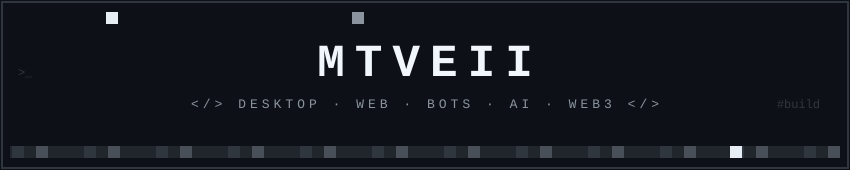

 

 

---

## ABOUT ME

**Hey there, I'm Matveii**  
I can build almost anything: `desktop` → `web` → `bots` → `AI` → `web3`  
Building **FastHub**: fast local workspace, no `Electron`  
`C++20 · Qt 6 · SQLite + FTS5 · CMake · Windows x64 / ARM64`

 

---

## TECHNOLOGIES

*if it compiles, I ship it*

**◆ CORE**

**◆ WEB & MOBILE**

**◆ BOTS · AI · WEB3**

**◆ TOOLS & PLATFORMS**

## PROJECTS

| PROJECT | STACK | WHAT |
| --- | --- | --- |
| **[FastHub](https://github.com/Mtveii/FASTHUB)** | `C++` `Qt` `SQLite` | native desktop workspace — fast, local, no `Electron` |
| **[Steam ASP.NET React](https://github.com/Mtveii/Steam_ASP.NET_Core_React)** | `ASP.NET` `React` | Steam web client |
| **[web3-rpg-contracts](https://github.com/Mtveii/web3-rpg-game-contractsy)** | `Solidity` `Web3` | RPG game contracts |
| **[ChatInsightBot](https://github.com/Mtveii/ChatInsightBot)** | `Python` | chat analytics bot |
| **[Python AI](https://github.com/Mtveii/Python_AI)** | `Python` | AI experiments |
| **[cpp-core](https://github.com/Mtveii/cpp-core)** | `C++` | core C++ libraries |

⚙️ [all repositories](https://github.com/Mtveii?tab=repositories)

---

## STATISTICS

<table>
<tr>
<td width="50%">

</td>
<td width="50%">

</td>
</tr>
<tr>
<td colspan="2">

</td>
</tr>
</table>

---

## CONTRIBUTION GRAPH

---

## SNAKE

---

[Telegram](https://t.me/Matvey739) · [Gmail](mailto:maatveii567@gmail.com) · [FastHub](https://github.com/Mtveii/FASTHUB)

